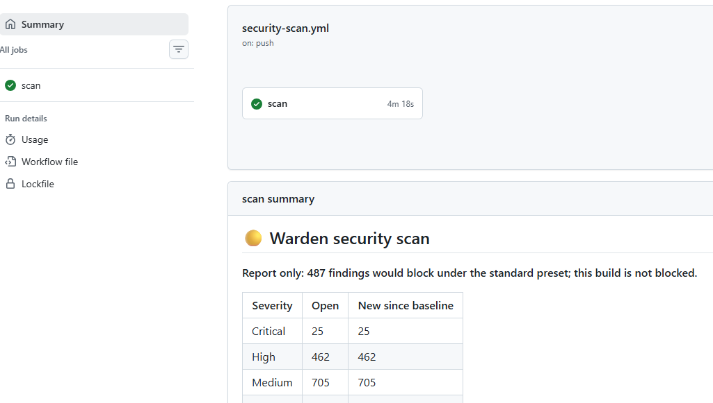
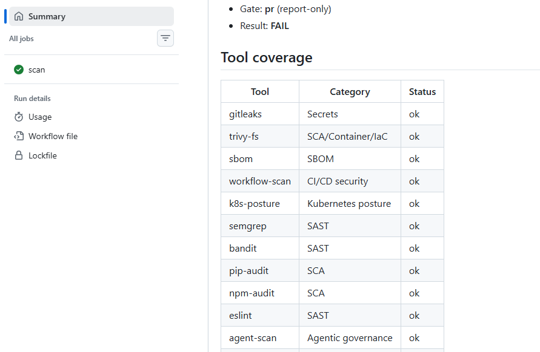
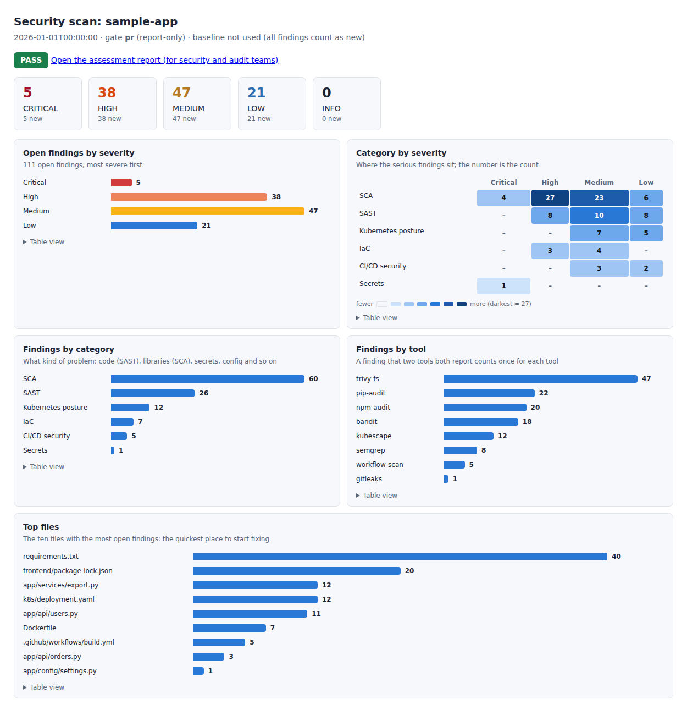
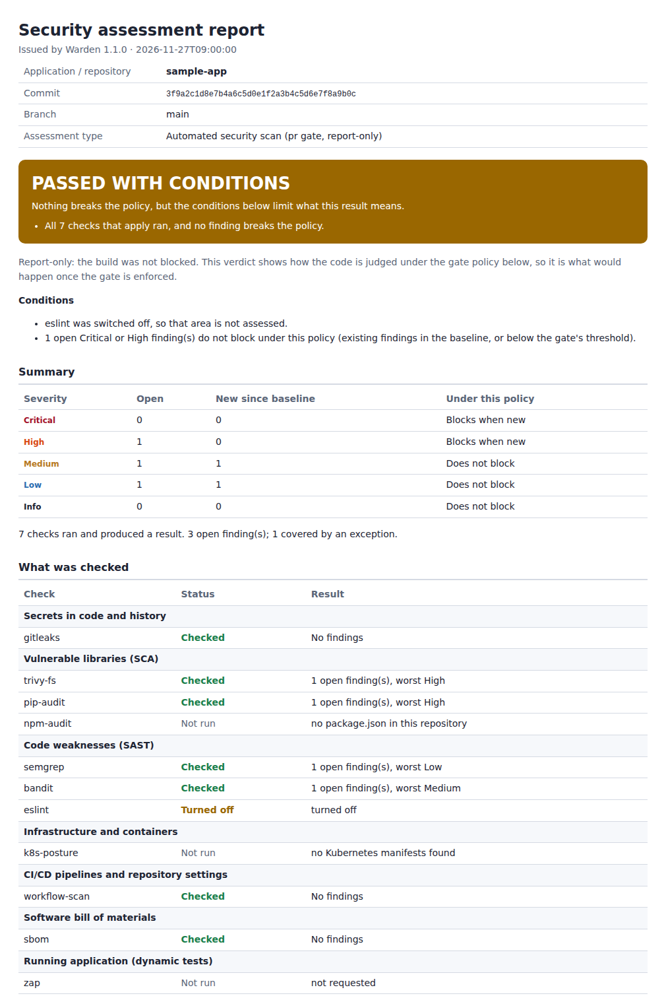

# Warden developer guide

Warden checks your repository for security problems on every pull request. You install it once, run `warden init`, set a few values, commit, and read the report in GitHub. It starts in **report-only mode**: nothing blocks a merge until your team turns the gate on.

**You need:** Git and Python 3.8+. GitHub's runners already have everything the scan needs.

## Step 1. Install Warden (once per machine)
```bash
python3 -m venv ~/.warden-venv
~/.warden-venv/bin/pip install "git+https://github.com/rakeshkolipakaTA/mckesson-security-kit.git@main"
mkdir -p ~/.local/bin && ln -sf ~/.warden-venv/bin/warden ~/.local/bin/warden
warden --version
```
Windows and other options: [GETTING-STARTED.md](GETTING-STARTED.md).

## Step 2. Initiate Warden in your repo
```bash
cd your-repo
warden init
```
It detects your stack and adds:
- `.security/`, with **the whole engine in `.security/kit`**, so GitHub Actions never needs access to our repository,
- `.security/config.env`, the one file you edit,
- `.github/workflows/security-scan.yml`, the pipeline,
- `.github/dependabot.yml`, weekly pull requests for outdated libraries (delete it if you do not want them).

An empty or new repo works too: checks that need no language run at once, and the Python, Node or Java checks start by themselves when those files appear.

## Step 3. Update `.security/config.env` if needed
The defaults are fine for a first run. Change a value with `warden config set KEY VALUE`, or edit the file.
```ini
SEC_PRESET=starter     # starter = report-only | standard = blocks new Critical/High | strict = release gate
# SEC_BANDIT=off       # turn a tool off (gitleaks, Semgrep and Trivy cannot be turned off)
# SEC_IMAGE=myapp:ci   # setting a target switches the matching scan on
# SEC_EXCLUDE_PATHS=vendor/**,legacy/**
```
**Optional tools are not needed for the scan.** Leave a tool's address out and it simply does not run. To switch one on, put its address in `config.env` and its token in a **GitHub secret** (Settings, Secrets and variables). Never put a token in `config.env`; Warden refuses it.

| Tool | Use it for | In `config.env` | GitHub secret |
|---|---|---|---|
| SonarQube | Code quality, smells, security hotspots | `SEC_SONAR=on`, `SEC_SONAR_HOST_URL=https://sonar.example.com`, `SEC_SONAR_KEY=my-project` | `SONAR_TOKEN` |
| DefectDojo | All findings of all repos in one register | `SEC_DEFECTDOJO_URL=...` | `DEFECTDOJO_TOKEN` |
| Dependency-Track | Alerts when a new CVE hits a library you shipped | `SEC_DTRACK_URL=...` | `DTRACK_API_KEY` |
| Warden dashboard | Scan history for all repos | `SEC_DASHBOARD_URL=...` | `WARDEN_DASHBOARD_TOKEN` |
| Wiz (licence needed) | Wiz CLI scans of code, IaC and images | copy the Wiz workflow template | `WIZ_CLIENT_ID`, `WIZ_CLIENT_SECRET` |

- DefectDojo, Dependency-Track and the dashboard start only when their address is set, and a problem with them never breaks your build. **SonarQube** fails if you switch it on without its URL and token, so switch it on only when both exist.
- The server must be **reachable from the runner**. A GitHub-hosted runner cannot reach a private address, so use a self-hosted runner (it needs Docker) for a SonarQube on your own network.

More: [integrations/](integrations/README.md).

## Step 4. Validate the setup
```bash
.security/warden doctor          # every line should be a green tick
.security/warden config show     # which checks will run on this repo, and why each one is skipped
```
`doctor` also checks Docker, which you only need if you scan on your own machine (Step 7). If a tool you switched on shows as skipped, the line says why (usually a missing address or token).

## Step 5. Choose the GitHub Actions triggers
Open `.github/workflows/security-scan.yml` and edit the `on:` block. The default scans every pull request and every push to `main` / `master`:
```yaml
on:
  pull_request:                       # every pull request (recommended)
  push:
    branches: [main, master]          # after a merge; add your own branch names here
  workflow_dispatch:                  # a "Run workflow" button
  # schedule:
  #   - cron: "0 3 * * 1"             # optional: weekly scan, Mondays 03:00 UTC
```
- **Pull requests only:** delete the `push:` lines.
- **Every push to a branch:** add it to `branches:` (`'**'` for all). Without an open pull request there is no comment, only the run summary and the report download.

## Step 6. Commit, push and watch the run
```bash
git checkout -b add-warden
git add .security .github
git commit -m "Add Warden security scanning (report-only)"
git push -u origin add-warden
```
Open a pull request, then watch the run: the **Actions** tab (workflow `security-scan`), or `gh run list --workflow security-scan.yml` and `gh run watch`. A first run takes a few minutes while the scanner images download and usually finds things; nothing blocks while `SEC_PRESET=starter`. Teammates only run `git pull`.

The run page shows the scan job and its summary:



## Step 7. Check locally (optional)
Not needed for GitHub to scan. To scan on your own machine, install and start **Docker** (the scanners run as Docker images), then:

| Command | Use it to |
|---|---|
| `.security/warden scan` | Full scan; prints where the report is. Report-only until the preset is `standard` |
| `.security/warden open` | Open the latest HTML report |
| `.security/warden quick` | One-minute check (secrets and code). `warden hook install` runs it before every push |
| `.security/warden gate` | Same scan, but fail on policy violations (what CI does once enforcing) |
| `.security/warden baseline` | Record today's findings as existing, so only **new** Critical and High findings block |

## What you see on every pull request
| Where | What |
|---|---|
| Pull request comment | One comment, updated on every push |
| Changed lines | Markers on the risky lines in "Files changed" |
| Run summary | The same result on the Actions run page |
| Report download | HTML report with charts, markdown, SARIF and SBOM, kept 14 days (the `security-report` artifact) |

The run summary lists the findings by severity and the most serious ones, new first. Below that is the tool coverage: every check that ran, and its status.



## Read the HTML report
The pull request comment is the short version. The **HTML report** is the full one, with charts, and it is the best place to decide what to fix first.

**Open it**
- **From GitHub:** open the run (**Actions** tab, the `security-scan` run), scroll to **Artifacts**, download `security-report`, unzip it and open `summary.html` (it is inside a folder named after the date) in your browser. It needs no internet and no login, so you can also send it to a teammate. The artifact is kept 14 days.
- **On your machine:** `.security/warden open` (after `.security/warden scan`).

**What is in it, top to bottom**
1. **Result and counts:** PASS or FAIL, and the number of Critical, High, Medium and Low findings, with how many are new.
2. **Charts:** findings by severity, a category-by-severity grid (the darker the cell, the more findings), findings by category, findings by tool, and the ten files with the most findings. Every chart has a **Table view** with the same numbers, and hovering a bar shows its value.
3. **Tools:** which checks ran, and which did not and why.
4. **Findings:** every finding with its file, line and fix hint. Filter by severity or tool, or tick "blocking only".



**A quick way to use it:** look at the severity chart first, then **Top files** (a few files often hold most findings), then the category grid to see whether the problem is libraries, code or configuration. Fix the Critical and High findings in the busiest files first. Details of every part: [reading-reports.md](reading-reports.md).

## The assessment report (for security and audit teams)
Every scan also writes `assessment.html`, one document for the person who has to decide whether the code is acceptable. It sits next to `summary.html` in the same download; open it with `.security/warden open assessment`, or from the link at the top of the report. Use the browser's **Print, Save as PDF** to attach it to a review or a release.



| It shows | So the reviewer can see |
|---|---|
| **Verdict**: PASSED, PASSED WITH CONDITIONS, INCOMPLETE or FAILED, with the reasons | The answer first, and what limits it |
| Application, commit, branch, Warden version, date | Exactly what was assessed |
| What was checked, by area | Which checks ran, and which did not and why (not applicable, turned off, waived, failed) |
| Policy applied | What blocks, the fix deadlines, whether a baseline is used |
| Accepted exceptions and waivers | What was excused, by whom and until when |
| Basis and limits, evidence hashes | That it is an automated scan, and that a copy matches the original |
| A blank sign-off block | A named person can decide and sign. Warden never fills it in |

- **A broken scanner is never a pass.** If a check gives no result the verdict is INCOMPLETE.
- **It is an automated assessment, not a certification.** It does not replace a penetration test or a review by a person, and it says so on the page.
- In report-only mode the build is not blocked; the verdict shows what would happen once the gate is enforced.
- Like the main report, it can contain file paths. Share it only with people who should see them. Details: [reading-reports.md](reading-reports.md#the-assessment-report).

## Fix a finding
1. Open the PR comment or report: each finding names the file, the line and, when known, the fix. Common fixes: [fixing-findings.md](fixing-findings.md).
2. Fix it and push. The comment updates itself.
3. Cannot fix it now? Add a **time-boxed exception** in `.security/exceptions.json` (owner and expiry date), never a silent ignore: [exceptions-and-baseline.md](exceptions-and-baseline.md).

**Roll out in steps:** report-only for 1 to 2 weeks, `warden baseline` for legacy findings, then `warden config set SEC_PRESET standard` to block new Critical and High ([timeline](GETTING-STARTED.md#step-5-roll-out-safely-recommended-timeline)).

**Your own tests** (pytest, Jest and so on) are not part of Warden. Keep them as their own step in the same workflow, for example `- run: pip install -r requirements.txt pytest && pytest`.

What is checked, per category: [checks/](checks/README.md).

## Where to use Warden in your pipeline (GitHub Actions)
| When | What runs | How |
|---|---|---|
| **Every pull request** (default) | Full scan, one PR comment, markers on risky lines | `security-scan.yml`, created by `warden init` |
| **After a merge to `main`** | Same scan on the merged code; feeds DefectDojo and Dependency-Track if set | The `push:` trigger of the same workflow |
| **Before a release or deploy** | Strict gate on code **and the built image**: blocks any Critical or High finding without an approved exception | Copy `.security/ci/security-release.github.yml` to `.github/workflows/security-release.yml` and edit the three `EDIT:` lines (image name, build step, push step) |
| **Against a running QA app** (optional) | ZAP dynamic test, on request | See "Run a ZAP test" below |
| **On a schedule** (optional) | Catches new CVEs in code that has not changed | Add a `schedule:` cron line to the `on:` block |

**Own workflow (recommended).** `security-scan.yml` runs next to your build and test workflows, in parallel. You change nothing in your current pipeline.

**Or a job in your existing workflow**, when a deploy must wait for the scan:
```yaml
jobs:
  test:
    # ... your existing build and test job ...
  security:
    runs-on: ubuntu-latest
    permissions:
      contents: read
      pull-requests: write                      # for the one PR comment
    steps:
      - uses: actions/checkout@11d5960a326750d5838078e36cf38b85af677262  # v4.4.0
        with:
          persist-credentials: false
      - run: .security/warden gate              # fails the job when the policy is violated
      - if: always()
        run: .security/warden ci-report         # PR comment, markers, run summary
        env:
          GITHUB_TOKEN: ${{ github.token }}
  deploy:
    needs: [test, security]                     # runs only when both passed
    # ... your existing deploy job ...
```
`warden scan` follows the preset (report-only on `starter`); `warden gate` always fails on a violation.

**Make it a required check** so a failing scan blocks the merge: set `SEC_PRESET=standard` (on `starter` the job is always green), then in GitHub **Settings, Branches** (or **Rules**) add a rule for `main` with **Require status checks to pass** and pick the check named `scan`.

**Other CI systems:** `warden init --ci jenkins`, `--ci azure` or `--ci all` writes the matching pipeline file. The commands are the same.

## Run a ZAP test on your running QA app (optional)
ZAP attacks a **running** app the way an outsider would and finds what reading code cannot: missing security headers, weak cookies, injection, broken access. It needs a deployed QA or UAT app, so it is **not part of the pull-request scan**. It runs **on request** from its own workflow. No test environment? Skip it.

| Piece | Where | What is in it |
|---|---|---|
| Settings per environment | `.security/zap/qa.env`, `uat.env` (created by `warden init`) | Targets, **allowed hosts**, login type. **No secrets.** Read only by `warden zap` |
| Secrets | GitHub **Environments** `qa`, `uat` | Test username, password or token, released only to a job in that environment |
| The run | `.github/workflows/security-dast.yml` | "Run workflow" with dropdowns for environment and mode, plus a weekly passive baseline of `qa` |
| Approval for attacks | Environment `zap-active-approval` | Mode `full` waits here for a reviewer |

**One-time setup (team lead)**
1. Edit `.security/zap/qa.env` (each line is explained). Set `SEC_ZAP_ALLOWED_HOSTS` (the hosts the app owner approved) and `SEC_ZAP_URL`. For an API add `SEC_ZAP_OPENAPI`; for a login add `SEC_ZAP_AUTH` and `SEC_ZAP_LOGIN_URL`.
2. Check it without sending anything: `.security/warden zap qa baseline --explain`.
3. In GitHub **Settings, Environments**, create `qa` (with the test credentials as environment secrets, if the app has a login) and `zap-active-approval` (with **Required reviewers**).
4. Copy `.security/ci/security-dast.github.yml` to `.github/workflows/security-dast.yml`. For a login, uncomment only the secret lines your login type needs ([zap-authentication.md](zap-authentication.md)). Use a self-hosted runner if the QA app is not reachable from the internet.
5. Put `.security/` and `.github/workflows/security-*.yml` under CODEOWNERS, because `.security/zap/` decides what gets attacked. Commit and push to `main`.

**Run it:** in GitHub, Actions, `security-dast`, **Run workflow**, then pick the environment and mode (the result is in the run summary and the `zap-report-<environment>` artifact). On your machine (needs Docker): `.security/warden zap qa baseline`, with logins from `warden creds set ZAP_AUTH_PASSWORD` (hidden input, kept outside the repo).

| Mode | What it does | Use it for |
|---|---|---|
| `baseline` | Passive: reads responses, sends no attacks | The first run. Finds little on a pure API |
| `api` | Tests every endpoint from your OpenAPI spec (`SEC_ZAP_OPENAPI`) | APIs |
| `full` | **Active**: sends attack traffic to the URLs you list (with parameters, e.g. `.../search?q=test`) | A deep test; needs a reviewer's approval |

**Built-in protections, checked before any traffic:** the run stops unless the target host is on `SEC_ZAP_ALLOWED_HOSTS` (`host` or `*.suffix`); without a list, hosts named like production are refused; an address or a settings file containing a password is refused; and only ZAP runs.

**Best practices**
- **Never production.** An active scan creates and changes data. Use QA or UAT with test data you can reset.
- **Start passive:** `baseline`, then `api`, then `full` on a short list of URLs.
- **Not on every pull request.** It is slow and needs a deployed app: the weekly baseline plus a manual run after a QA deployment is enough.
- **Tell the QA team and the app owner** before a scan, avoid demo and test hours, and allow-list the runner if a WAF or rate limiter is in front.
- **One dedicated test account per environment:** least privilege, used only by the scanner, with an expiry date. Never a real person's or a production account.
- **A human triages the findings.** Missing headers are usually quick wins; record an accepted false positive as a time-boxed exception.

## Best practices
- **Secrets:** never in code, `config.env`, workflow inputs or URLs. Use GitHub secrets (an Environment with required reviewers for production). A real secret found in code is leaked: **rotate it**, then remove it.
- **Workflow safety:** keep `permissions:` minimal and `persist-credentials: false` on checkout, never use `pull_request_target` to get write access on fork pull requests, and pin actions to a full commit SHA (the generated files do; Dependabot keeps them current).
- **The engine lives in your repo:** protect `.security/` and `.github/` with CODEOWNERS ([template](../modes/per-project/templates/CODEOWNERS.snippet)) and do not edit `.security/kit` by hand. To upgrade, install a newer Warden, run `warden init` and review the diff in a pull request; your config, exceptions and baseline are kept.
- **Treat "tool missing" as a failure to fix.** A scan that cannot run a required tool fails closed and never reports "clean" by accident.
- **Reports** list findings and dependencies and stay 14 days. That is fine in a private repo; if a repo may ever become public, turn off the PR comment (`WARDEN_PR_COMMENT=off`) and the artifact first.

**Help:** [troubleshooting.md](troubleshooting.md) or `.security/warden doctor`. If your network blocks semgrep.dev: [offline-and-blocked-networks.md](offline-and-blocked-networks.md).
